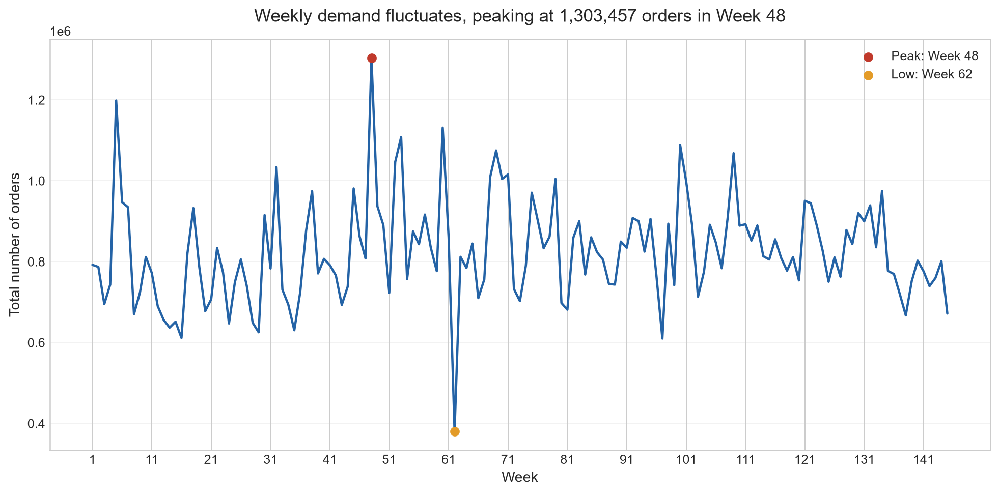
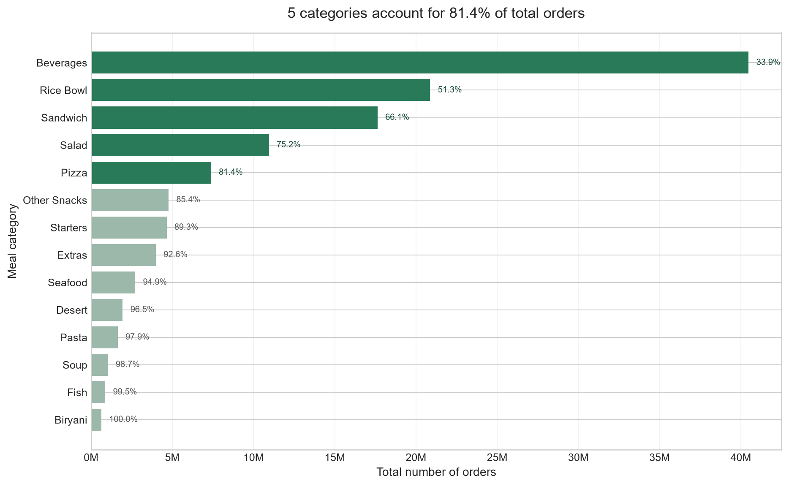
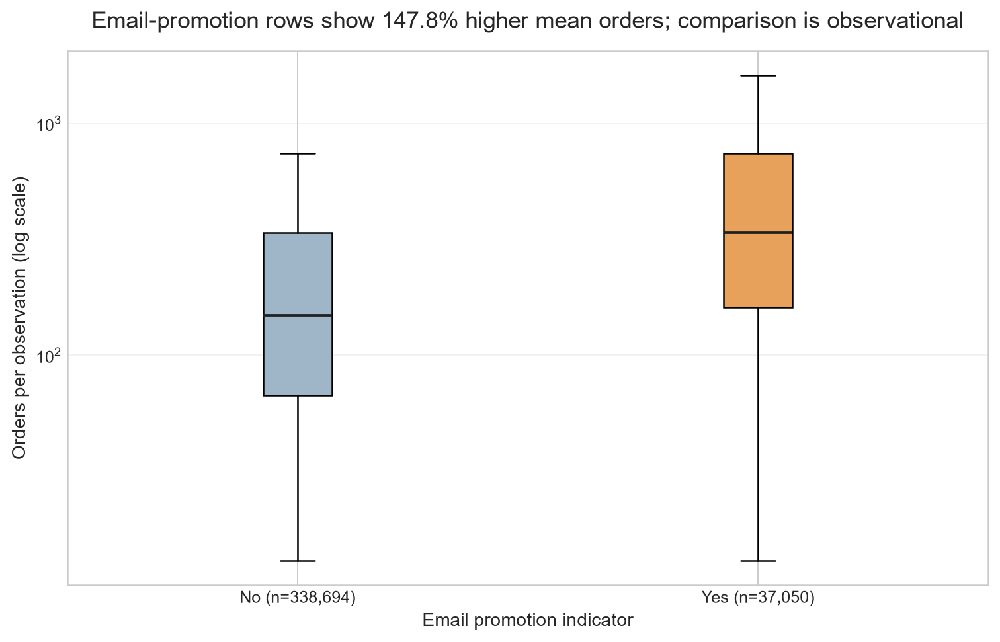
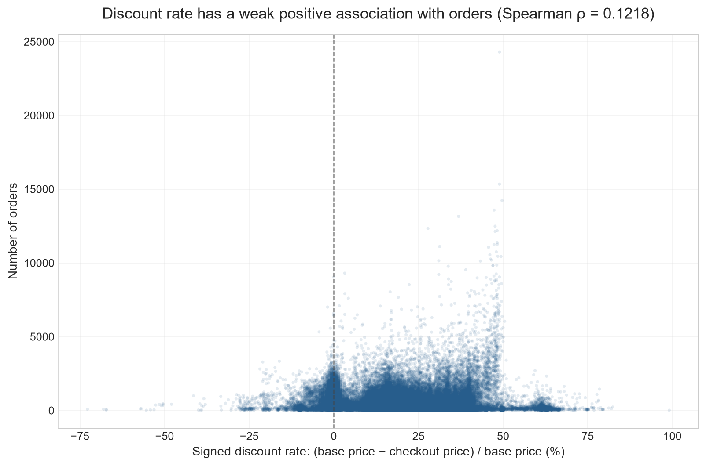
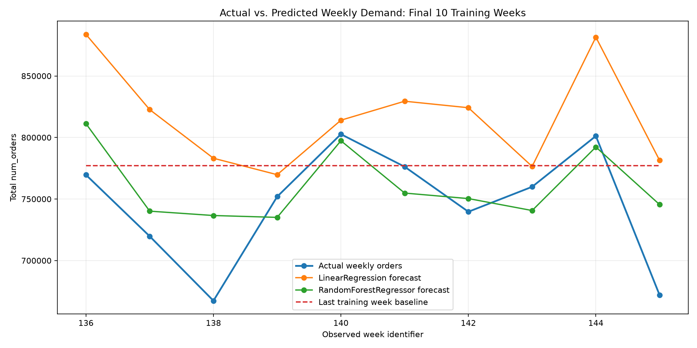

# Food Demand Analysis: Client Summary

## Executive summary
Five meal categories account for 81.40% of all 119,557,485 recorded orders.  
The data covers 145 observed weeks; Week 48 had the highest weekly demand at 1,303,457 orders.  
The top 22 meals contribute 81.18% of orders, indicating that demand is concentrated among a subset of meals.  
Email-promotion observations had 147.84% higher mean orders, but this observational comparison does not establish a promotional effect.  
Meal 1885 is both high-demand and relatively stable: 8,346,246 total orders and a weekly-demand CV of 0.191.

The weekly forecasting comparison selected a Random Forest: its MAE was **28,735.96 orders** across the final 10 observed training weeks, compared with **70,614.65** for Linear Regression and **41,012.80** for a last-training-week baseline. These are measured errors on the temporal holdout, not a guarantee of future accuracy. The selected model produced row-level predictions for all 32,573 rows in `test.csv`; that file has no observed `num_orders`, so no test-file MAE is available.

## Q1 — Weekly demand

The prepared training data contains **119,557,485 orders** across **145 observed weeks**, averaging **824,534.38 orders per observed week**. Week **48** had the highest total (**1,303,457**), while Week **62** had the lowest (**380,065**). The first-to-last observed-week total changed by **−15.19%**; this endpoint comparison does not establish a sustained trend or explain its cause.

*Weekly totals vary across observed weeks; the figure describes the pattern and does not explain its causes.*

## Q2 — Demand concentration

The five categories needed to reach at least 80% are **Beverages, Rice Bowl, Sandwich, Salad, and Pizza**. Together they account for **81.40%** of orders. The top **22 of 51 meals** account for **81.18%**; their meal IDs, in descending order of total orders, are:

`2290, 1885, 1754, 1993, 1109, 2707, 1971, 2826, 1727, 1062, 2664, 2490, 2569, 1778, 1962, 2539, 2581, 2322, 2640, 1230, 1207, 1558`

The 80% threshold is a descriptive measure of order concentration, not evidence that a category or meal caused demand.

*Bars are ranked by total orders; highlighted categories are the set that reaches the 80% threshold.*

## Q3 — Fulfilment-center performance

| Center type | Share of recorded orders |
| --- | ---: |
| TYPE_A | 57.69% |
| TYPE_B | 25.09% |
| TYPE_C | 17.22% |

Center totals are not directly comparable as measures of typical center performance because observation counts, meal mix, and operating area can differ. Seventy-six centers have observations in all 145 weeks; center 24 has 120 observed weeks. The project reports center averages per observed week, but does not adjust them for operating area or product mix.

## Q4 — Promotion-associated demand

Promotion flags were analyzed separately: `emailer_for_promotion` represents the email indicator, while `homepage_featured` represents homepage placement. Comparisons were restricted to meal-center pairs appearing in both indicator states; weekly rows were then pooled across eligible pairs.

| Indicator | Eligible pairs | Rows without / with indicator | Mean orders without / with | Mean difference | Mann–Whitney U |
| --- | ---: | ---: | ---: | ---: | ---: |
| Email promotion | 2,830 | 338,694 / 37,050 | 254.64 / 631.10 | +147.84% | 8,740,582,324.5 |
| Homepage featured | 2,928 | 338,548 / 49,855 | 241.37 / 594.88 | +146.46% | 11,694,179,707.5 |

Nominal two-sided asymptotic p-values underflow the floating-point representation (log10 p approximately **−3,364.14** for email promotion and **−4,214.30** for homepage featuring; the two-test Holm-adjusted log10 values are approximately **−3,364.14** and **−4,214.00**, respectively). These should **not** be treated as confirmatory evidence: observations repeat across weeks within meal-center pairs, violating the ordinary Mann–Whitney independence assumption. The comparisons are row-weighted, observational associations and do not show that promotion caused higher demand.

*The box plot compares the eligible row-level distributions on a logarithmic scale; labels show sample sizes.*

## Q5 — Discount and demand

For **456,548 valid rows**, Spearman’s rank correlation between signed discount rate and order count was **ρ = 0.1218**, a **weak positive association**. The two-sided p-value is below **1e−300** at the available floating-point precision. A small p-value does not mean the association is strong, and correlation does not prove that discounts caused demand to change. Email promotion, homepage featuring, and other time-varying factors may coincide with price changes.

*Negative rates are retained when checkout price exceeds base price; the scatter plot shows association, not a causal effect.*

## Q6 — Meal demand and volatility

Meal **2290** ranked highest in total demand, with **9,770,303 orders**, mean weekly orders of **67,381.40**, and CV **0.900**. Meal **2444** had the highest CV (**1.205**), with **942,568 total orders** and **6,500.47 mean weekly orders**. Meal **1885** had **8,346,246 total orders** and a lower CV of **0.191**.

Total order volume and volatility answer different questions: total orders measure cumulative scale, while the coefficient of variation is the sample standard deviation of weekly meal totals divided by their mean. Volatility is not, by itself, a measure of poor performance. Of **7,395** possible meal-week combinations in the observed range, **222** were not observed. Because the data does not establish whether those meals were offered, missing combinations were not treated as zero demand; CVs use observed weeks only.

## Three actionable recommendations

1. **Decision:** Consider prioritizing demand-planning review for the five leading categories. **Supporting evidence:** these categories account for **81.40%** of recorded orders. **Success metric:** weekly stockout rate and unfulfilled-order rate for those categories. **Measurement approach:** establish current category-level baselines, track both measures weekly, and compare subsequent periods while recording any changes in supply or assortment.
2. **Decision:** Review replenishment buffers and operational planning separately for high-volume stable meals and high-CV meals. **Supporting evidence:** meal 1885 has **8,346,246** orders and CV **0.191**, while meal 2444 has CV **1.205** and **942,568** orders. **Success metric:** meal-level stockout rate and forecast error, reported separately by demand/volatility group. **Measurement approach:** establish a baseline from observed weeks, monitor comparable future weeks, and avoid interpreting unobserved meal-weeks as zero demand.
3. **Decision:** Before increasing promotion investment, consider a controlled promotion test with a pre-defined comparison design. **Supporting evidence:** observed email-promotion rows have **147.84%** higher mean orders, but repeated observations and confounding prevent a causal interpretation. **Success metric:** incremental orders per eligible meal-center-week and incremental revenue or margin per promotion cost, as defined by the business. **Measurement approach:** randomize promotion assignment among comparable eligible meal-center-week units where feasible, account for repeated units in the analysis, and compare with a concurrent control before deciding whether to scale.

4. **Decision:** Use the weekly forecast as one input to ingredient purchasing, inventory buffers, and staffing schedules. **Supporting evidence:** on the final 10 observed training weeks, the selected Random Forest's weekly-total MAE was **28,735.96 orders**. **Practical use:** compare forecasted weekly demand with current stock, supplier lead times, shelf life, and staffing capacity; prioritize closer monitoring and flexible replenishment where forecast uncertainty or meal-level variation is high. **Caution:** forecasts support planning decisions but do not guarantee demand; verify them against actual orders and operational constraints each week.

## Weekly demand forecasting

Weekly demand is defined as the sum of `num_orders` across all meal-center rows with the same observed `week`. Week values are identifiers, not calendar dates. The model learns row-level orders from `center_id`, `meal_id`, week, prices, and promotion/featured flags; center and meal IDs are one-hot encoded and `id` is excluded. Row predictions are summed to weekly totals for evaluation.

The latest 10 training weeks (weeks **136–145**) were kept out of model fitting. On these same weeks, **LinearRegression MAE was 70,614.65 orders**, **RandomForestRegressor MAE was 28,735.96**, and the baseline that repeats week 135's total had MAE **41,012.80**. MAE is the mean absolute difference between actual and predicted weekly totals, in orders; lower is better. The Random Forest was selected because it had the lowest holdout MAE among the two requested machine-learning models. It also outperformed the simple baseline on this holdout, but this limited comparison does not ensure future performance.

The selected model was refit on all 456,548 training rows and generated `predicted_num_orders` for each of the 32,573 rows in `test.csv`. Test weeks are aggregated separately for planning reference. The test file has no actual `num_orders`, so its accuracy cannot be measured here.

## Limitations and interpretation

- Week values are week identifiers; the files do not provide actual calendar dates. The data also does not establish specific city coverage or geographic representativeness.
- A missing meal-week record does not prove that a meal was offered with zero orders. These records are excluded from observed-week means and CVs rather than imputed.
- Estimated revenue is `checkout_price × num_orders` summed over rows. It is not audited financial revenue.
- Promotion comparisons pool repeated weekly observations and may be confounded by price, featured placement, timing, or other factors. The ordinary Mann–Whitney independence assumption is not satisfied, so nominal p-values are exploratory.
- The discount-demand correlation is observational and does not prove that discounting changes demand.
- Center comparisons use observed-week averages but are not adjusted for operating area or product mix.
- Forecast features contain no prior realized demand history, actual calendar dates, availability/stockout information, or external context such as holidays and weather. The 10-week holdout evaluates weekly aggregate totals only; it does not guarantee row-level accuracy or generalization to later operating conditions.

Reported figures above are observed summaries or exploratory associations. Possible explanations are not established by this analysis, and no causal effect is claimed.
